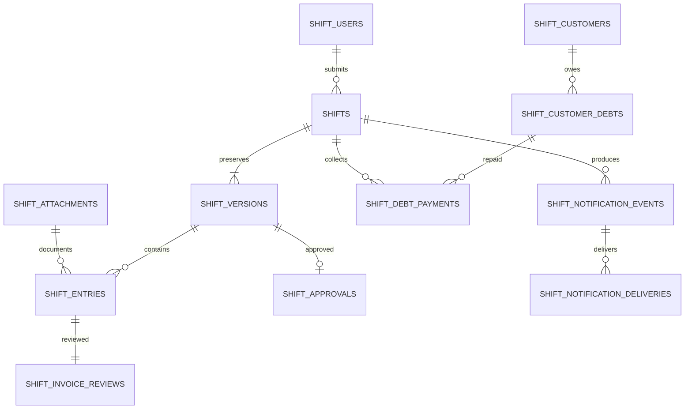

> **ملاحظة إصدار 2.2:** بعض الأقسام أدناه تخص الإصدار السابق، مثل الديون، مطابقة الفواتير، العجز والفائض وحساب النقد المعدود. مسارات API وصفحات هذه المزايا متوقفة في 2.2، ولا تُنشأ قيود ديون جديدة. الاعتماد الجديد يتم من سجل الورديات بقرار إداري دون جرد نقدي. راجع `docs/UPDATE_V2_2_AR.md` و`README_AR.md` للأوامر المعتمدة حاليًا.

# قاعدة بيانات سوبر ماركت بن دول — الإصدار 2

قاعدة التشغيل: PostgreSQL مع SQLAlchemy وPsycopg 3. المقادير المالية `NUMERIC(18,2)`، والحساب في Python باستخدام `Decimal`. مخطط SQL الكامل موجود في `postgresql-v2-schema.sql`، والترحيلات التنفيذية في `backend/shift_migrations`.

## الجداول ومصادر الحقيقة

| الجدول | الاستخدام |
|---|---|
| shift_users | حسابات الموظفين والمديرين، وكلمات المرور المجزأة Argon2id |
| shift_auth_sessions / shift_login_throttles | جلسات الدخول ومحدد المحاولات الدائم |
| shift_settings | المتجر والريال اليمني والمنطقة الزمنية والعهدة الأولى وقفل المعاملات |
| shifts | هوية الوردية والموظف، وتاريخ الصندوق الحالي، ومؤشر أحدث نسخة والنسخة المعتمدة |
| shift_versions | بيانات كل نسخة: تاريخ الصندوق والإيداع، رقمهما، المبيعات، الجرد، الملاحظات والسبب |
| shift_entries | التفاصيل المنفصلة: مشتريات، أصناف خارج الجهاز، ديون، وتحويلات |
| shift_attachments | المرفقات الاختيارية للمشتريات والديون والتحويلات، واسم الملف ونوعه وبصمته ومحتواه BYTEA |
| shift_invoice_reviews | نتيجة مراجعة كل سطر وربط تسديد الحساب السابق بالدين المحدد |
| shift_references | حجز مراجع الإيداع والحوالات والفواتير ومنع إعادة استخدامها في وردية أخرى |
| shift_customers / shift_customer_debts | حسابات العملاء وأصل كل دين معتمد، بما فيه الدين الافتتاحي |
| shift_debt_payments | تسديدات الحساب السابق المعتمدة؛ كل صف مصدره خط بنكي واحد |
| shift_approvals | لقطة مالية ثابتة لكل نسخة معتمدة مع المدير والوقت والملاحظة |
| shift_audit_logs | سجل إضافي للتسليم والمراجعة والتصحيح والصلاحيات والإشعارات |
| shift_idempotency | مفتاح الطلب وبصمة HMAC والرد، لمنع تكرار الحفظ عند إعادة المحاولة |
| shift_notification_events / shift_notification_deliveries | أحداث إشعار ثابتة وحالة إرسال منفصلة لكل قناة |

كل مبالغ التفاصيل تأتي من صفوف `shift_entries` الخاصة بالنسخة المحددة. لا توجد حقول موازية لإعادة إدخال مجموع المشتريات أو الديون. التقارير المعتمدة تقرأ `shift_approvals.totals_json`، حتى لا يتغير التاريخ إذا عدلت معادلة في إصدار لاحق. السجلات غير المعتمدة تحسب من تفاصيلها الحالية.

`totals_json` و`payload_json` لقطات واعتمادات وإشعارات؛ ليستا بديلًا عن الجداول العلائقية للتعاملات. الجداول المالية تحمل مفاتيح خارجية وفهارس وقيود عدم السالب والبيانات المالية الأساسية؛ رقم الفاتورة والمرفقات اختيارية لصفوف المشتريات والديون والتحويلات.

## العلاقات الأساسية



## المعاملات والتزامن

- تبدأ كل كتابة بتحديث صف `shift_settings` الوحيد، فيبقى قفل قاعدة البيانات قائمًا إلى `COMMIT`. هذا اختيار مناسب لصندوق واحد، ويمنع تعارض مستخدمين أو عاملَي n8n.
- فحص الصلاحية ومفتاح الطلب والنسخة، وتسجيل التفاصيل والمراجع والمرفقات ودفتر الديون والتدقيق والإشعار يتم داخل المعاملة نفسها.
- يسمح بأكثر من وردية للموظف في التاريخ نفسه. يظل رقم سند الإيداع محجوزًا بشكل فريد بين الورديات، ويمنع مفتاح الطلب تكرار عملية التسليم ذاتها. يعتمد المدير الورديات بالتسلسل الزمني ثم معرّف الوردية داخل صندوق واحد.
- `expected_version` يمنع اعتماد صفحة قديمة بالتزامن مع تصحيح جديد.
- رصيد الدين يعاد فحصه وقت الاعتماد تحت القفل، ولو سبق أن طابقه مدير آخر أثناء المراجعة.
- مفتاح `Idempotency-Key` له رد محفوظ وبصمة HMAC مرتبطة بالمستخدم والمسار والجسم. المفتاح نفسه مع بيانات مختلفة يعيد `409`.
- لا تجمع المصادر القديمة والنسخ الحالية في أثر نقدي واحد. تعتمد الوردية نسخة واحدة، وتسديد المصدر الواحد له `source_key` فريد.
- قراءات تقارير PostgreSQL تستخدم لقطة `REPEATABLE READ READ ONLY` لضمان اتساق الفترة أثناء قراءة نسخها.

## النسخ والتصحيح

لا توجد واجهات لحذف التعاملات المالية المعتمدة. التصحيح ينشئ نسخة جديدة مع سبب إلزامي. النسخة الأصلية ولقطة اعتمادها لا تعدلان. تمنع Triggers تحديث أو حذف النسخ والتفاصيل والاعتمادات والتدقيق وأحداث الإشعار.

قبل اعتماد التصحيح الجديد، تظل آثار الديون والتسديدات السابقة نافذة. عند الاعتماد يستبدل أثر الوردية في دفتر الديون داخل معاملة واحدة، مع حفظ الحالة قبل وبعد في التدقيق. لا يسمح بتخفيض دين دون تسديداته أو نقل دين مسدد لعميل مختلف.

الرصيد الافتتاحي للعميل مستقل عن مبيعات أي وردية، ويمكن عكسه بسبب موثق إذا لم توجد عليه تسديدات. حذف المستخدم يعني تعطيل الوصول وإلغاء جلساته؛ تبقى تعاملاته باسمه ورقمه.

## تشغيل الترحيلات

نفذ من مجلد `backend` باستخدام حساب مالك المخطط عند الإعداد:

```powershell
.\.venv\Scripts\python.exe -m alembic -c shift_alembic.ini upgrade head
```

لا تشغل ترحيلات SQL Server القديمة `alembic.ini` لهذا الإصدار. الترحيلات الجديدة تستخدم جدول `shift_alembic_version` مستقلًا. لا توجد عملية نقل تلقائي من قاعدة SQL Server قديمة؛ تبقى بياناتها دون تغيير، ويلزم فحص خاص قبل أي نقل تشغيلي.

الترحيل `20261030_03` يزيل قيد الموظف والتاريخ الواحد ويحدّث قيود الفواتير لتتيح المرفقات والأرقام الاختيارية؛ يحافظ على السجلات الموجودة. شغله بعد نسخ احتياطي متحقق منه، وباختبار مسبق على نسخة مستعادة في قاعدة منفصلة.

الترحيلات المالية إلى الأمام فقط. الاسترجاع يكون إلى قاعدة جديدة من نسخة احتياطية، وليس بإسقاط الجداول.

## النسخ الاحتياطي والاستعادة

من PowerShell، مع وجود أدوات PostgreSQL في PATH:

```powershell
.\scripts\backup-windows.ps1 -Database bin_doul -DatabaseUser postgres
.\scripts\restore-windows.ps1 -BackupFile C:\Backups\bin_doul.dump -TargetDatabase bin_doul_restore_20261029 -DatabaseUser postgres
```

الأوامر تطلب كلمة مرور قاعدة البيانات؛ لا تمررها في سطر الأوامر. `pg_dump` بنمط Custom يحفظ لقطة متسقة، والمرفقات موجودة داخل القاعدة نفسها. احتفظ بالنسخ في وجهة أخرى محمية، وأضف نسخة آمنة من إعدادات الخادم وأسراره وفق آلية إدارة أسرارك.

الاستعادة تنشئ قاعدة مستقلة ولا تمس قاعدة التشغيل. السكربت يلغي جلسات الدخول في النسخة المستعادة، ويوقف مهام الإشعار المعلقة بحالة تحتاج تحققًا لتجنب إرسال رسائل سبق إرسالها بعد تاريخ النسخة. افحص المجاميع والمرفقات والصلاحيات، ثم غيّر `DATABASE_URL` وأعد تشغيل الخدمة عند اعتماد النسخة المستعادة. لا تشغل n8n عليها قبل مراجعة الإشعارات.

ملف الصلاحيات الاختياري `postgres-runtime-permissions.sql` يفصل حساب التشغيل عن مالك المخطط. نفذه بعد الترحيلات وعيّن كلمة مرور الدور تفاعليًا. لا تعط n8n حساب مالك قاعدة البيانات.

مراجع: [PostgreSQL pg_dump](https://www.postgresql.org/docs/17/app-pgdump.html)، [Psycopg](https://www.psycopg.org/psycopg3/docs/basic/install.html).
