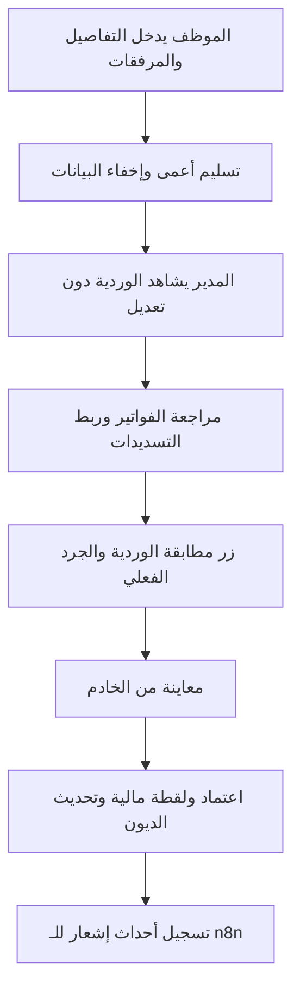

> **ملاحظة إصدار 2.2:** بعض الأقسام أدناه تخص الإصدار السابق، مثل الديون، مطابقة الفواتير، العجز والفائض وحساب النقد المعدود. مسارات API وصفحات هذه المزايا متوقفة في 2.2، ولا تُنشأ قيود ديون جديدة. الاعتماد الجديد يتم من سجل الورديات بقرار إداري دون جرد نقدي. راجع `docs/UPDATE_V2_2_AR.md` و`README_AR.md` للأوامر المعتمدة حاليًا.

# تعريفات ومعادلات الإصدار 2

العملة الوحيدة: **الريال اليمني YER**. لا يوجد تحويل عملات أو مزج عملتين. الإدخال يقبل فواصل الآلاف والأرقام العربية، ويعيد الخادم تحويل المبلغ إلى `Decimal` بدقة منزلتين. المدخل ذو أكثر من منزلتين، والسالب، والرقم الثنائي التقريبي غير المقبول، يرفض. تستخدم العمليات سياسة `ROUND_HALF_UP` عند التكميم إلى منزلتين.

## الحقول

| الحقل | المعنى |
|---|---|
| قيمة الصندوق | إجمالي مبيعات جهاز المحاسبة، وليس النقد الموجود في الدرج |
| تاريخ الصندوق | تاريخ التقرير في الجهاز؛ أساس الأرشفة اليومية والشهرية وتقارير الموظفين |
| قيمة الإيداع | النقد المسلّم أو المودع من الصندوق؛ لا تضم تحويلات العملاء |
| رقم وتاريخ سند الإيداع | المرجع والتاريخ الفعليان للسند، مستقلان عن تاريخ الصندوق |
| مشتريات الصندوق | فواتير مدفوعة نقدًا من الدرج فقط، بأسماء وتفاصيل؛ رقم الفاتورة والمرفق اختياريان |
| الأصناف خارج الجهاز | مبيعات نقدية غير مشمولة في إجمالي الجهاز، باسم ورقم وعدد وإجمالي بيع الصف |
| دين الوردية | الجزء غير المسدد من فاتورتها وقت نشوء الدين، مع الاسم والتفاصيل والإجمالي؛ رقم الفاتورة والمرفق اختياريان |
| تحويل فاتورة الوردية | سداد بنكي لفاتورة مشمولة أصلًا في مبيعات الجهاز؛ لا يزيد المبيعات ثانية |
| تسديد حساب سابق | حوالة لسداد دين أقدم، يربطها المدير بالدين المحدد؛ لا تزيد المبيعات أو نقد الدرج |
| مبيعات الشبكة | بطاقات جهاز الدفع فقط؛ منفصلة عن تحويلات الفواتير وعن تحصيل الحساب السابق |
| آخر جرد | النقد المتبقي المعدود بعد الإيداع، في تاريخ ورديته فقط، وليس رصيدًا حيًا حاليًا |

أرقام الأصناف والمراجع والفواتير نصوص تحفظ أصفار البداية، ولا تضاف إليها فواصل الآلاف. المبالغ تعرض مثل `10,000.50`. يجب ألا يجمع صف دين فاتورة مع كامل الجزء المحول من الفاتورة مرة أخرى. إذا كانت الفاتورة 1,000 والتحويل 300 والدين 700، يسجل الدين 700 وإجمالي الفاتورة 1,000. إذا ربطا برقم فاتورة غير فارغ نفسه يفحص الخادم مجموعهما وتطابق صاحبها. عند غياب الرقم، لا يربط الخادم العمليات آليًا؛ يجب على المدير التحقق من الارتباط والتصنيف قبل الاعتماد.

التسديدات اللاحقة لا تعدّل أصل دين الوردية يدويًا. تسجل كسداد حساب سابق مستقل، والرصيد المتبقي يساوي أصل الدين ناقص التسديدات المعتمدة الفعالة.

## المعادلات

```text
المبيعات الإجمالية = مبيعات الجهاز + المبيعات النقدية خارج الجهاز

مبيعات الجهاز النقدية = إجمالي مبيعات الجهاز
                      - مبيعات الشبكة
                      - ديون فواتير الوردية غير المسددة
                      - التحويلات البنكية لفواتير نفس الوردية

النقد المتوقع قبل الإيداع = العهدة الافتتاحية المعتمدة
                          + مبيعات الجهاز النقدية
                          + المبيعات النقدية خارج الجهاز
                          - المشتريات النقدية من الصندوق

النقد الموثق عند الإغلاق = الإيداع المسلّم + المتبقي المعدود بعد الإيداع
فرق المطابقة = النقد الموثق - النقد المتوقع قبل الإيداع
```

السالب عجز، والموجب فائض، والصفر مطابق. العجز والفائض ليسا حساب صافي خسارة أو ربح تجاري. يرفض احتساب مبيعات جهاز نقدية سالبة حتى لو كان هناك بيع خارج الجهاز يمكنه إخفاء الخطأ عند الجمع.

عند خلو الجرد لا يحتسب صفرًا، وتظهر حالة الانتظار. المعاينة واعتماد المطابقة يعاد حسابهما في الخادم؛ لا يقبل الخادم مجاميع محسوبة من المتصفح.

## مثال

عهدة 500، مبيعات جهاز 3,000، شبكة 1,200، ديون 300، مشتريات 400، دون بيع خارج الجهاز: المتوقع قبل الإيداع 1,600. إذا كان الإيداع 1,550 والمتبقي صفرًا فالعجز 50.

حوالة 200 لفاتورة من نفس الوردية تجعل المتوقع 1,400، مع بقاء إجمالي المبيعات 3,000. أما حوالة 200 لحساب سابق فلا تغيّر المتوقع 1,600، وتخفض الدين القديم 200 بعد المراجعة والاعتماد.

## دورة العمل



أول عهدة تحدد من إعدادات المدير قبل أول اعتماد. بعد ذلك يرحّل **المتبقي الفعلي المعتمد بعد الإيداع** إلى الوردية التالية، لا النقد المتوقع. يعتمد المدير الورديات الجديدة بالتسلسل. يمكن استلام بيانات أيام لاحقة للمراجعة، لكن اعتمادها ينتظر اعتماد الأقدم.

تصحيح وردية قديمة متاح بنسخة جديدة وسبب. إذا اعتمدت وردية لاحقة على رصيدها، لا يسمح بتغيير الرصيد المرحل أو ترتيب تاريخها في هذا الإصدار. يمكن تصحيح بقية البيانات مع ثبات الرصيد المرحل وإعادة المراجعة والاعتماد.

## التقارير

تاريخ سند الإيداع لا يحدد شهر الوردية؛ مثلًا تقرير جهاز 30 سبتمبر وسند إيداع 1 أكتوبر يؤرشف في سبتمبر. مجموع إيداعات إغلاقات سبتمبر ليس كشف حركة البنك لشهر سبتمبر.

إجمالي العجز، وإجمالي الفائض، وصافي الفرق ثلاثة مؤشرات مستقلة. مبيعات الفترة تشمل التسليمات الحالية حتى لو كانت معلقة، بينما فروقها تدخل بعد اعتماد النسخة الحالية فقط. الأرصدة الافتتاحية وأرصدة الجرد لا تجمع بين الأيام.

كل فاتورة ومصدر نقدي يؤثر مرة واحدة. لا يولد النظام سجل صرف موازٍ لفاتورة الشراء ثم يجمع الاثنين. تفاصيل النسخ القديمة تبقى للأرشيف ولا تدخل في التجميع الحالي.
