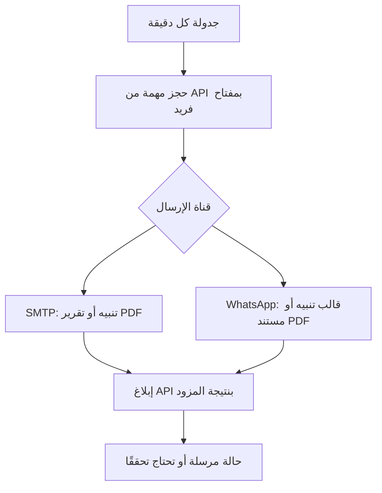

# ربط سوبر ماركت بن دول بـ n8n

يوجد مسارا عمل JSON جاهزان للاستيراد، وكلاهما **غير مفعّل** ولا يحتوي أي كلمة مرور أو مستلم:

1. `01_financial_notifications.json`: يفحص صندوق الإرسال كل دقيقة، ويرسل تنبيهات البيع خارج الجهاز (مع دعم أحداث العجز القديمة المحفوظة فقط)، أو تقرير الموظف الشهري مع PDF.
2. `02_monthly_employee_reports.json`: الساعة 6 صباح أول يوم من الشهر بتوقيت `Asia/Aden`، يطلب تقارير الشهر المكتمل السابق، تقريرًا مستقلًا لكل موظف له ورديات.

المستلم الافتراضي في التصميم هو المدير الذي تضبط عنوانه ورقم واتسابه. التقرير يفصل كل موظف؛ لا يرسل إلى عناوين موظفين غير مسجلة. لا توجد رسائل لتحصيل ديون العملاء.

## الإعداد

1. شغّل التطبيق وPostgreSQL أولًا. في `.env` الخاص بالتطبيق، ضع قيمة عشوائية طويلة في `N8N_API_TOKEN`، وحدد `NOTIFICATION_CHANNELS=email` أو `email,whatsapp`، ثم أعد تشغيل التطبيق. السكربت `setup-windows.ps1` يولد مفتاحًا عشوائيًا محليًا إذا أنشأ `.env` جديدًا.
2. داخل n8n أنشئ Credential من نوع **Header Auth** باسم `Bin Doul API`. اسم الرأس `Authorization` وقيمته `Bearer ` متبوعة بالمفتاح نفسه. لا تستخدم اسم مستخدم المدير أو كلمة مروره للربط.
3. اضبط متغيرات بيئة n8n الموضحة في `.env.example` داخل هذا المجلد. لا تنسخ الملف فوق `.env` الخاص بالتطبيق. `BIN_DOUL_API_URL` هو عنوان التطبيق الذي يستطيع خادم n8n الوصول إليه؛ إذا كان n8n خدمة Windows على الجهاز نفسه يصل عادة إلى `http://127.0.0.1:8000`.
4. أنشئ SMTP Credential باسم `Bin Doul SMTP` واضبط بريد المرسل والمدير. استورد الملف الأول واختر الـ Credentials الفعلية في عقد HTTP وSend Email؛ أسماء ملفات الاستيراد لا تنشئ أسرارًا تلقائيًا.
5. لواتساب: تحتاج إعداد WhatsApp Cloud API، ورقم الإرسال، وBearer Token، ومستلم المدير بصيغة دولية، وإصدار Graph API صالح لحسابك. أنشئ Header Auth باسم `WhatsApp Cloud Bearer` برأس `Authorization: Bearer ...`.
6. أنشئ واعتمد قالب التنبيه المحدد في `BIN_DOUL_WHATSAPP_ALERT_TEMPLATE` بجسم ذي متغيرين: اسم المتجر، وملخص الحدث. قالب `BIN_DOUL_WHATSAPP_MONTHLY_TEMPLATE` له رأس Document وثلاثة متغيرات جسم: المتجر، الموظف، الشهر. يجب مطابقة اللغة وعدد المتغيرات داخل Meta مع العقد.
7. في n8n الذي يمنع قراءة متغيرات البيئة من العقد، اسمح للمتغيرات المطلوبة وفق سياسة إعداد نسختك أو أدخل القيم غير السرية في العقد يدويًا. تبقى رموز الاتصال داخل Credentials فقط.
8. جرّب على قاعدة عينة ومستلم تملكه وتوافق على الإرسال إليه، ثم فعّل المسارين بعد التحقق. لا يحتاج مسار الإشعارات إلى حساب PostgreSQL أو صلاحية كتابة مباشرة في جداول المبيعات.

## ما يحدث داخل المسار

عند تجهيز التقرير يحفظ الخادم لقطة بياناته في حدث ثابت. تحميل PDF بواسطة رمز الخدمة يعيد هذه اللقطة، كي لا يتغير المرفق إذا صححت وردية بعد تجهيز الإشعار.

المبالغ في الحمولة نصوص عشرية. العقد تنسقها للعرض دون عمليات حساب مالي. الحساب والربط والتحقق في FastAPI. لا تسجل التكاليف أو الديون بكتابة مباشرة من n8n.

## حالات الإرسال والتكرار

- الحدث يسجل في المعاملة المالية نفسها، وقيد فريد يمنع تكرار الحدث والقناة.
- كل مهمة لها حجز مؤقت ورمز تأكيد. إعادة طلب الحجز بالمفتاح نفسه لا تنشئ مهمة أخرى، وبعد تأكيده لا يعاد كعمل جديد.
- فشل الاتصال بعد محاولة الإرسال لا يثبت أن المزود لم يرسل؛ المسار يضع الحالة «تحتاج تحققًا» ولا يعيد محاولة المزود تلقائيًا.
- الحجز المنتهي دون تأكيد يتحول إلى الحالة نفسها. المدير يراجع المزود ثم يجيز إعادة المحاولة بسبب مسجل من صفحة الإشعارات.
- «مرسل» يعني قبول عملية الإرسال من المزود بحسب نتيجة n8n، وليس إثبات قراءة المستلم للرسالة. لا يوجد ادعاء ضمان إرسال خارجي مرة واحدة مطلقًا في حالات انقطاع الشبكة.
- تكرار تجهيز التقرير نفسه لا يولد أحداثًا مكررة. تصحيح معتمد أو نسخة حالية مختلفة يولد لقطة تقرير جديدة مميزة.

الصلاحيات الخاصة برمز الخدمة محصورة في حجز الإشعارات وتأكيدها وتجهيز التقارير الشهرية وقراءة ملفات PDF للأحداث. لا يضيف مستخدمين ولا يعدل الورديات.

## الاختبارات المنفذة وحدودها في 2.4

نُفّذ الاستيراد الفعلي والتشغيل بواسطة n8n 2.41.7 مع FastAPI وPostgreSQL 17.11، مع تبديل Schedule Trigger إلى Manual Trigger في نسخ اختبارية فقط. جُرّب إعداد تقارير الشهر السابق، وتنبيه الأصناف عبر SMTP محلي، وقالب واتساب على مزود HTTP محلي، ومرفق التقرير عبر البريد ورفع مستند واتساب، ثم إقرار النتائج في صندوق الإرسال. تحققت أيضًا حالة مزود محلي 503 وانتهاء القائمة دون إعادة أو تكرار إرسال. أُصلح خطأ نهايات أقواس عبارات JSON الذي كان يمنع إرسال واتساب في الملفات القديمة. ملفات التسليم الأصلية تظل غير مفعّلة.

لم تستخدم بيانات اتصالك ولم تُرسل رسائل لأشخاص حقيقيين. SMTP ومزود Meta وقوالب حسابك وWebhook إيصالات التسليم والجدولة الزمنية الحقيقية غير مختبرة على تثبيتك. يجب ضبط Credentials واختبارها مع مستلم تملكه وتوافق على مراسلته قبل التفعيل. نجاح مزود محلي لا يثبت تسليم رسالة من الحساب الحقيقي أو قراءتها.

المراجع الرسمية: [HTTP Request](https://docs.n8n.io/integrations/builtin/core-nodes/n8n-nodes-base.httprequest/)، [Send Email](https://docs.n8n.io/integrations/builtin/core-nodes/n8n-nodes-base.sendemail/)، [Schedule Trigger](https://docs.n8n.io/integrations/builtin/core-nodes/n8n-nodes-base.scheduletrigger/)، [WhatsApp Business Cloud](https://docs.n8n.io/integrations/builtin/app-nodes/n8n-nodes-base.whatsapp/).
